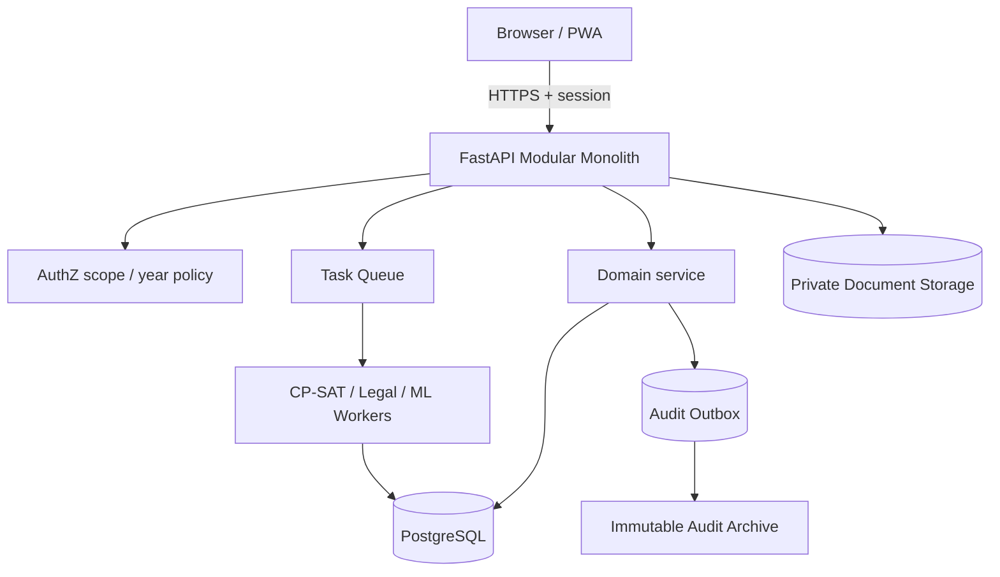
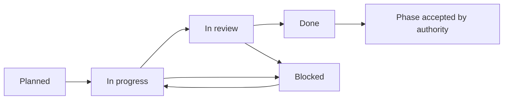

# Data flow and control diagrams (Mermaid)

## Application and trust boundaries

## Task lifecycle

Diagrams reflect intended architecture, not deployed services. Regenerate/review when an ADR changes the boundaries.
